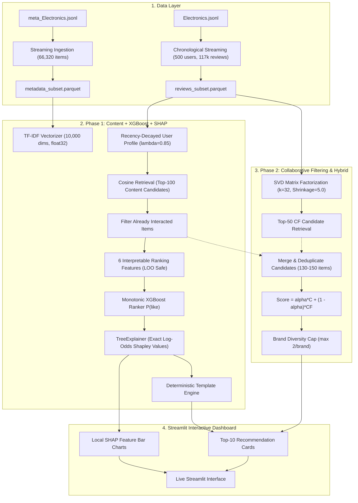
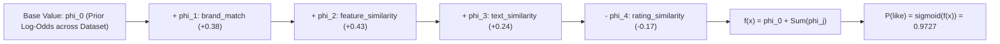

# Explainable Hybrid Recommendation System with Context and Influence Awareness
## Master System Documentation, Mathematical Formulations, Architecture Decisions & Viva Defense Guide
**Team LOGIC LOOP** · *B.Tech CSE (Data Science), Final Year Project*  
**Dataset:** Amazon Reviews 2023 (`Electronics` Category Subset — 66,320 Catalog Products, 500 Heavy Users)  
**System Version:** Release Candidate 2 (Phase 1 Content + Phase 2 SVD Hybrid + Interactive Streamlit Showcase)

---

## Table of Contents
1. [Executive Summary & Core Motivation](#1-executive-summary--core-motivation)
2. [Data Layer & Ingestion Engineering](#2-data-layer--ingestion-engineering)
3. [Phase 1: Content Representation & User Profiling](#3-phase-1-content-representation--user-profiling)
4. [Phase 1: Candidate Generation, Ranking Features & Leakage-Free XGBoost](#4-phase-1-candidate-generation-ranking-features--leakage-free-xgboost)
5. [Phase 1: SHAP Explainability & The Natural-Language Engine](#5-phase-1-shap-explainability--the-natural-language-engine)
6. [Phase 2: SVD Matrix Factorization & Hybrid Score Combination](#6-phase-2-svd-matrix-factorization--hybrid-score-combination)
7. [Quantitative Evaluation, Metrics & Empirical Findings](#7-quantitative-evaluation-metrics--empirical-findings)
8. [Major Engineering Challenges Faced & How We Solved Them](#8-major-engineering-challenges-faced--how-we-solved-them)
9. [Frontend Guide: How to Walk Through the UI in a Demo/Viva](#9-frontend-guide-how-to-walk-through-the-ui-in-a-demoviva)
10. [Anticipated Professor Viva / Defense Questions & Model Answers](#10-anticipated-professor-viva--defense-questions--model-answers)

---

## 1. Executive Summary & Core Motivation

### 1.1 The Industry & Academic Problem
Traditional recommendation systems face a fundamental trade-off:
* **Collaborative Filtering (CF)** and **Deep Learning Recommenders** (e.g. Matrix Factorization, Two-Tower Neural Networks, Autoencoders) find high-order latent interaction patterns, but they operate as **opaque black boxes**. When a user asks *"Why was this item recommended to me?"*, matrix latent factors ($\mathbb{R}^{32}$) cannot be mapped to human reasoning.
* Furthermore, collaborative filtering collapses when encountering **catalog cold-start items** (newly added products with zero or very few interaction histories).
* Standard **Content-Based Filtering** models offer interpretability by matching keywords, but simple cosine similarity ranking lacks predictive nuance and ignores non-linear interactions between brand loyalty, price proximity, and review sentiment.

### 1.2 Our Architectural Mission
This project builds an **Explainable Hybrid Recommender System** where:
1. **Explainability is a First-Class Citizen**: Every single recommendation is accompanied by an exact attribution of evidence grounded in **Cooperative Game Theory (SHAP / Shapley values)**, translated deterministically into plain-language sentences without hallucination.
2. **Hybrid Signal Fusion**: A Stage-1 Content-Based TF-IDF engine generates candidates and handles cold-start catalog items, while a Stage-2 SVD Matrix Factorization collaborative engine injects community co-rating patterns.
3. **Strict Zero-Leakage Protocol**: Both training and temporal evaluation enforce strict Leave-One-Out invariants preventing target leakage and temporal data snooping.



---

## 2. Data Layer & Ingestion Engineering

### 2.1 Raw Dataset Characteristics
We utilize the **Amazon Reviews 2023 (`Electronics` category)** dataset provided by McAuley Lab:
* `Electronics.jsonl.gz`: Multi-gigabyte interaction file containing user reviews, ratings (1.0 to 5.0), timestamps, review text, and product IDs.
* `meta_Electronics.jsonl.gz`: Multi-gigabyte catalog file containing titles, bullet-point feature lists, descriptions, brand/store attributes, price, categories, and hierarchical breadcrumbs.

### 2.2 Streaming Ingestion & Joint Subsetting (Section 6)
> [!CAUTION]
> **Anti-Pattern Avoided**: Never randomly sample 1% of the reviews file and 1% of the metadata file independently. Independent random samples will produce almost zero intersection, resulting in users with single reviews, disconnected products, and broken profile vectors.

Our ingestion engine in [`src/data/subset_data.py`](file:///c:/Users/arpit/Desktop/Explainable-Recommender-System/src/data/subset_data.py) executes a coordinated line-by-line streaming pass:
1. **Streaming Reviews Pass**:
   - Stream `Electronics.jsonl.gz` line-by-line via `gzip` without ever loading the full file into memory.
   - Filter rows missing required keys (`user_id`, `parent_asin`, `rating`, `timestamp`).
   - Group counts per user: select users who have **$\ge 20$ ratings** (`min_ratings_per_user: 20`), retaining up to **500 heaviest users** (`max_users: 500`).
   - **Retain 100% of interactions** for those selected users (do not sub-sample their histories; temporal splitting requires their entire historical sequence).
   - Collect the exact set of unique `parent_asin` values present across those interactions.
2. **Streaming Metadata Pass**:
   - Stream `meta_Electronics.jsonl.gz` line-by-line.
   - Retain metadata **only** if its `parent_asin` exists in the collected set from Step 1.
3. **Persisted Compact Working Sets**:
   - `data/processed/reviews_subset.parquet`: 117,490 deduplicated reviews across 500 users (62.5 MB).
   - `data/processed/metadata_subset.parquet`: 66,320 catalog products (60.4 MB).
   - All subsequent phases read exclusively from these Parquet files.

### 2.3 Canonical Product ID: `parent_asin` (Section 5)
Amazon products often have dozens of minor variants (e.g., iPhone 128GB in Black, Blue, White) sharing different raw `asin` codes.
* If raw `asin` were used as the primary key, user interaction histories would fragment across colors, distorting review counts and splitting collaborative signals.
* We enforce `parent_asin` as the **canonical universal identifier** across all data structures, models, and lookups. Raw `asin` is retained only for display.

### 2.4 Chronological Leave-One-Out Protocol (Section 8)
To evaluate the recommender realistically without temporal data snooping:
1. For every user, all interactions are ordered strictly by Unix `timestamp`.
2. The user's most recent interaction is held out as the **Test Set** (`holdout_k = 1`), while all preceding interactions form the **Training Set**.
3. **Temporal Invariant**:
   $$\max(\text{Timestamp}_{\text{train}}(u)) \le \min(\text{Timestamp}_{\text{test}}(u)) \quad \forall u \in \mathcal{U}$$
   This is enforced by unit tests in [`src/data/splitter.py`](file:///c:/Users/arpit/Desktop/Explainable-Recommender-System/src/data/splitter.py).

---

## 3. Phase 1: Content Representation & User Profiling

### 3.1 Combined Product Representation (Section 9)
Rather than maintaining separate representations for title, description, and tags, we concatenate product metadata into a single unified textual document per product:
$$\text{Document}_i = \text{clean}(\text{Title}_i) + \text{ " " } + \text{clean}(\text{Features}_i) + \text{ " " } + \text{clean}(\text{Description}_i) + \text{ " " } + \text{clean}(\text{Categories}_i) + \text{ " " } + \text{clean}(\text{Brand}_i)$$

* **Text Preprocessing**: Lowercased, punctuation stripped via regex `r"[^\w\s]"` (replacing punctuation with spaces to prevent merging adjacent words), multiple spaces collapsed, and standard English stopwords removed.
* **Vectorization**: [`ContentVectorizer`](file:///c:/Users/arpit/Desktop/Explainable-Recommender-System/src/content/text_features.py) fits a scikit-learn `TfidfVectorizer`:
  * Vocabulary ceiling: $10,000$ features (`max_features: 10000`).
  * Minimum document frequency: $2$ products (`min_df: 2`).
  * Sublinear term frequency: $\text{tf} = 1 + \ln(\text{count})$ (`sublinear_tf: True`), preventing long feature descriptions from dominating.
  * Normalization: L2 unit norm ($\|V_i\|_2 = 1.0$).
  * Precision: Stored as `np.float32` sparse CSR matrix (50.36 MB serialized), saving 40% memory over 64-bit floats.

### 3.2 User Profile Vector $P_u$ & Recency Decay (Section 10)
A user's profile vector $P_u \in \mathbb{R}^{10,000}$ represents their semantic center of interest.

#### The Mathematical Weighting Formula:
$$P_u = \frac{\sum_{i \in \mathcal{H}_u} w_i \cdot V_i}{\|\sum_{i \in \mathcal{H}_u} w_i \cdot V_i\|_2}$$

Where the scalar interaction weight $w_i$ is a product of **Rating Weight** and **Exponential Recency Decay**:
$$w_i = w_{\text{rating}}(r_i) \cdot (\lambda)^{\text{rank}_i}$$

```
Interaction Rank (Chronological Descending):
Rank 0 (Most Recent Interaction)   --> Weight: 1.0 * (0.85)^0  = 1.0000
Rank 1 (Second Most Recent)         --> Weight: 1.0 * (0.85)^1  = 0.8500
Rank 2 (Third Most Recent)          --> Weight: 1.0 * (0.85)^2  = 0.7225
Rank 5                              --> Weight: 1.0 * (0.85)^5  = 0.4437
Rank 10                             --> Weight: 1.0 * (0.85)^10 = 0.1969
Rank 20                             --> Weight: 1.0 * (0.85)^20 = 0.0388
```

#### Why Non-Negative Rating Weights?
* $5\star \to 1.0$
* $4\star \to 0.75$
* $3\star \to 0.0$ (Neutral: ignored in profile vector)
* $1\star - 2\star \to 0.0$ (Negative: excluded from positive profile)

> [!NOTE]
> **Design Justification**: In TF-IDF vector spaces, terms have strictly non-negative values $[0, 1]$. If negative weights (e.g. $-1.0$) are averaged in, vector dimensions become negative, causing cosine similarities to become negative and geometrically unstable. Low ratings are not discarded from the system; they are leveraged in the downstream XGBoost ranking stage as negative training examples.

#### Why Recency Decay ($\lambda = 0.85$)?
In our dataset, power reviewers have 200 to 1,000+ purchases spanning up to a decade. Without recency decay, a camera cable bought in 2014 contributes equally with audio gear bought yesterday. Setting $\lambda = 0.85$ dynamically prioritizes current tastes while preserving long-term brand affinity.

### 3.3 Cold-Start Popularity Fallback (Section 10)
When a user has zero review history, personalized TF-IDF cannot be computed. Rather than failing or returning null, [`PopularityRecommender`](file:///c:/Users/arpit/Desktop/Explainable-Recommender-System/src/content/user_profile.py) scores products using a Bayesian-damped volume metric:
$$\text{Score}_{\text{pop}}(i) = \text{AverageRating}_i \cdot \ln(1 + \text{ObservedReviews}_i \times 10 + \text{CatalogRatingNumber}_i)$$
* Picks top items with a category diversification cap ($\le 2$ items per category).
* Returns recommendations assigned a baseline score of $0.50$ with clear cold-start explanations: *"Popular item with top customer ratings across the catalog"*.

---

## 4. Phase 1: Candidate Generation, Ranking Features & Leakage-Free XGBoost

### 4.1 Two-Stage Architecture
Evaluating all 66,320 items through an XGBoost model with feature extraction for every user requires $500 \times 66,320 \approx 33.1 \text{ million}$ inferences, which would take 15+ minutes per recommendation request.
* **Stage 1 (Retrieval)**: Fast sparse matrix dot product $S_{\text{cosine}} = P_u \cdot \text{TFIDF}_{\text{catalog}}^T$. Cosine similarity is computed in $< 5\text{ms}$. Top-100 candidates are retrieved.
* **Stage 1 Filtering**: Products the user has already interacted with are explicitly masked out ($S = -1.0$).
* **Stage 2 (Ranking)**: The 100 candidate items are scored by an XGBoost model using 6 engineered features.

### 4.2 Brand Diversity Post-Processing Cap (Section 11)
Without diversity controls, high-scoring brands (such as Amazon Basics or Anker) can capture all top-10 slots.
* We enforce a post-ranking filter: **maximum 2 items per brand** in the final top-$K$ (`diversity_cap_per_brand = 2`).
* If the diversity constraint defers candidates, lower-ranked unique-brand items are promoted, ensuring variety in the demo.

### 4.3 The 6 Interpretable Ranking Features (Section 12)
Every (user $u$, candidate $i$) pair is transformed into a 6-dimensional feature vector:

| Feature Name | Mathematical Definition | Range | Conceptual Meaning |
| :--- | :--- | :---: | :--- |
| `text_similarity` | $\cos(P_u, V_i) = P_u^T V_i$ | $[0.0, 1.0]$ | Semantic overlap between user's profile and item text. |
| `category_similarity` | $\min\left(1.0, \frac{\sum_{c \in \text{Cats}_i} \text{Weight}_u(c)}{\text{TotalCatWeight}_u} \times 3.0\right)$ | $[0.0, 1.0]$ | Recency-weighted overlap with user's preferred subcategories (excludes generic `"electronics"`). |
| `brand_match` | $\mathbb{I}(\text{Brand}_i \in \text{PreferredBrands}_u)$ | $\{0.0, 1.0\}$ | 1.0 if user has rated this brand $\ge 4\star$ in their positive history, else 0.0. |
| `feature_similarity` | $\min\left(1.0, \frac{\sum_{t \in \text{Tokens}_i} \text{FeatWeight}_u(t)}{\text{TotalFeatWeight}_u} \times 3.0\right)$ | $[0.0, 1.0]$ | Overlap between candidate feature tokens and user's past liked feature words. |
| `price_similarity` | $\frac{1}{1 + \left\|\ln(1 + \text{Price}_i) - \ln(1 + \text{MeanPrice}_u)\right\|}$ | $(0.0, 1.0]$ | Proximity of item price to user's log-normal historical spending habits. Default $0.5$ if price is null. |
| `rating_similarity` | $\max\left(0.0, 1.0 - \frac{\left\|\text{AvgRating}_i - \text{MeanRating}_u\right\|}{4.0}\right)$ | $[0.0, 1.0]$ | Proximity of item's average catalog rating to the user's historical rating standard. |

### 4.4 The Target Leakage Problem & Algebraic Leave-One-Out Solution
> [!CRITICAL]
> **The Leakage Bug Discovered**: In a naive implementation, if a training row is user $u$'s review of item $i$, computing `brand_match` against user $u$'s summary will see that item $i$'s brand is in user $u$'s profile. Consequently, `brand_match` will evaluate to $1.0$ for virtually all positive training samples. The model learns that `brand_match` is an infallible predictor in-sample, and collapses when evaluated on unseen test items.

#### The O(1) Algebraic Leave-One-Out (LOO) Algorithm:
To construct training row $(u, i)$ without target leakage, item $i$ must be strictly removed from user $u$'s summary. Rather than re-iterating over 200 items for every sample ($O(N^2)$), we compute the full profile once, and perform an exact algebraic subtraction in $O(1)$:

1. **Full Profile**: $\mathbf{F} = \sum_{j} w_j \mathbf{v}_j$, and scalar $\|\mathbf{F}\|^2 = \mathbf{F} \cdot \mathbf{F}$.
2. **LOO Vector Dot Product**:
   $$\mathbf{F}_{\text{LOO}} \cdot \mathbf{v}_i = (\mathbf{F} - w_i \mathbf{v}_i) \cdot \mathbf{v}_i = (\mathbf{F} \cdot \mathbf{v}_i) - w_i \|\mathbf{v}_i\|^2$$
3. **LOO Vector Norm**:
   $$\|\mathbf{F}_{\text{LOO}}\|^2 = \|\mathbf{F}\|^2 - 2w_i (\mathbf{F} \cdot \mathbf{v}_i) + w_i^2 \|\mathbf{v}_i\|^2$$
4. **LOO Text Similarity**:
   $$\text{text\_similarity}_{\text{LOO}} = \frac{\mathbf{F}_{\text{LOO}} \cdot \mathbf{v}_i}{\sqrt{\|\mathbf{F}_{\text{LOO}}\|^2}}$$
5. **LOO Brand & Category Deductions**:
   Item $i$'s brand weight and category counts are decremented by $w_i$. If the remaining brand weight $\le 0$, `brand_match` is set to $0.0$.

### 4.5 XGBoost Classifier with Monotonic Constraints
* **Labeling Rule (Section 12)**:
  * Rating $\ge 4.0 \to \text{Label } 1$ (Positive preference)
  * Rating $\le 2.0 \to \text{Label } 0$ (Negative preference)
  * Rating $== 3.0 \to$ Ignored (Ambiguous neutral, omitted from training)
* **Hyperparameters**: `max_depth = 3`, `n_estimators = 100`, `learning_rate = 0.05`, `random_state = 42`.
* **Monotone Constraints**: `monotone_constraints = (1, 1, 1, 1, 1, 1)`.
  * *Reasoning*: A higher `text_similarity` or matching `brand_match` must mathematically **never decrease** the predicted probability of liking the product. Monotonic constraints prevent decision trees from learning spurious negative splits on small sub-branches.

---

## 5. Phase 1: SHAP Explainability & The Natural-Language Engine

### 5.1 Why SHAP? (Cooperative Game Theory)
SHAP (Shapley Additive exPlanations) originates from game theory (Lloyd Shapley, 1953). In our context:
* **The Game**: Predicting the log-odds of a user liking an item.
* **The Players**: The 6 ranking features ($x_1, \dots, x_6$).
* **The Payout**: The margin output of the XGBoost model $f(x)$.



#### The Additivity Axiom:
$$\ln\left(\frac{P(\text{like})}{1 - P(\text{like})}\right) = \phi_0 + \sum_{j=1}^{6} \phi_j(x)$$
Where:
* $\phi_0$: The base value (expected model log-odds across the training distribution).
* $\phi_j(x)$: The exact contribution (in log-odds) assigned to feature $j$.

### 5.2 Deterministic Natural Language Engine (Section 14)
> [!IMPORTANT]
> **No LLM Hallucinations**: In mission-critical enterprise systems, explanation text must be verifiable. We use an explicit rule-based template engine that maps top positive and negative SHAP contributions directly to human sentences.

```
If SHAP contribution phi_j > +0.001 (Positive Driver):
  • brand_match          --> "Strong match with {brand} products in your history"
  • feature_similarity    --> "Similar product features"
  • text_similarity       --> "Similar to products you previously liked"
  • category_similarity   --> "Matches your preferred category ({category})"
  • rating_similarity     --> "Highly rated by users with similar standards"
  • price_similarity      --> "Fits within your typical price range"

If SHAP contribution phi_j < -0.001 (Negative Driver):
  • brand_match          --> "From a brand new to your purchase history"
  • feature_similarity    --> "Features differ from your typical selections"
  • text_similarity       --> "Different textual style from your past purchases"
  • category_similarity   --> "Explores a category outside your usual preferences"
  • rating_similarity     --> "Rating variance compared to your standard preferences"
  • price_similarity      --> "Price differs from your usual spending range"
```

### 5.3 Concrete Worked Example (Section 15)
For user `AE37Q6TCPNWG...`, the system recommends product `B093BP318W` (*RAZERMIC MXR10 Camera Microphone*):
* **Predicted Score $P(\text{like})$**: `0.9727`
* **Raw Features**:
  * `feature_similarity`: $0.9957$
  * `brand_match`: $1.0$ (User previously purchased Razermic equipment)
  * `text_similarity`: $0.2806$
  * `rating_similarity`: $0.8443$
  * `category_similarity`: $0.5842$
  * `price_similarity`: $0.5000$
* **Exact SHAP Attribution Breakdown ($\phi_j$)**:
  * `feature_similarity`: **$+0.4304$**
  * `brand_match`: **$+0.3716$**
  * `text_similarity`: **$+0.2403$**
  * `category_similarity`: **$+0.0540$**
  * `price_similarity`: **$-0.0015$**
  * `rating_similarity`: **$-0.1716$**
* **Resulting Output Explanations Displayed in UI**:
  1. *"Similar product features"* (driven by $\phi = +0.4304$)
  2. *"Strong match with razermic products in your history"* (driven by $\phi = +0.3716$)
  3. *"Similar to products you previously liked"* (driven by $\phi = +0.2403$)
  4. *"Rating variance compared to your standard preferences"* (driven by $\phi = -0.1716$)

---

## 6. Phase 2: SVD Matrix Factorization & Hybrid Score Combination

### 6.1 Collaborative Filtering Formulation (Section 16)
Collaborative Filtering discovers latent user-item co-occurrence patterns that text cannot capture (e.g. users who buy DSLR lenses also buy tripod mounting plates, even if their descriptions use different vocabularies).

#### The Model Architecture:
We construct a sparse user-item matrix $R \in \mathbb{R}^{500 \times 66,320}$ strictly from training reviews.
1. **User Centering**: Compute user mean rating $\mu_u$.
2. **Shrinkage-Damped Item Biases**:
   $$b_i = \frac{\sum_{u \in \mathcal{U}_i} (r_{u,i} - \mu_u)}{|\mathcal{U}_i| + \lambda_{\text{shrink}}}, \quad \lambda_{\text{shrink}} = 5.0$$
   *Damping prevents single-review products from acquiring extreme biases.*
3. **Centered Residual Matrix**:
   $$R_{\text{centered}}(u, i) = r_{u,i} - \mu_u - b_i$$
4. **Truncated SVD (Singular Value Decomposition)**:
   $$R_{\text{centered}} \approx U \Sigma V^T$$
   * Factors: $k = 32$ latent dimensions (`n_factors: 32`).
   * Symmetrically absorbed singular values: $\mathbf{P}_u = U \sqrt{\Sigma}$, $\mathbf{Q}_i = V \sqrt{\Sigma}$.
5. **Rating Prediction**:
   $$\hat{r}_{u,i} = \text{clip}\left(\mu_u + b_i + \mathbf{P}_u^T \mathbf{Q}_i, \quad 1.0, \quad 5.0\right)$$
6. **Normalized CF Score in $[0.0, 1.0]$**:
   $$\text{CF}(u, i) = \frac{\hat{r}_{u,i} - 1.0}{4.0}$$

### 6.2 Hybrid Candidate Merging
In [`HybridRecommender.recommend`](file:///c:/Users/arpit/Desktop/Explainable-Recommender-System/src/pipeline/recommender.py):
1. Top-100 candidates generated by Phase 1 Content Retrieval.
2. Top-50 unseen items generated by Phase 2 CF Latent Dot Product (`recommend_candidates`).
3. Candidates are merged and deduplicated (typically 130–150 distinct items), with all user-interacted products excluded.

### 6.3 Linear Hybrid Combination Formula (Section 17)
Every merged candidate is scored via:
$$\text{Score}_{\text{hybrid}}(u, i) = \alpha \cdot C(u, i) + (1 - \alpha) \cdot \text{CF}_{\text{effective}}(u, i)$$

Where:
* $C(u, i) \in [0, 1]$: Phase 1 XGBoost ranking probability $P(\text{like})$.
* $\text{CF}_{\text{effective}}(u, i)$:
  $$\text{CF}_{\text{effective}}(u, i) = \begin{cases} \text{CF}(u, i) & \text{if item } i \text{ was present in training ratings matrix} \\ C(u, i) & \text{if item } i \text{ is cold-start (unseen in CF)} \end{cases}$$
* $\alpha \in [0.0, 1.0]$: Hand-tunable weight (default $0.50$; interactive slider in Streamlit).
* **Explanation Extension**: When $\text{CF}$ contributes ($\alpha < 1.0$), an additional evidence sentence is appended:
  *"Collaborative affinity from similar users (CF score: 0.99)"*.

---

## 7. Quantitative Evaluation, Metrics & Empirical Findings

### 7.1 Temporal Evaluation Protocol (Section 20)
* **Population**: 500 test users, catalog of 66,320 items.
* **Ground Truth**: Chronological held-out final interaction per user ($k=1$).
* **Metrics**: Precision@$K$, Recall@$K$, NDCG@$K$ ($K \in \{5, 10\}$).

$$\text{Precision@}K = \frac{|\text{Recs}_K \cap \text{GroundTruth}|}{K}, \quad \text{Recall@}K = \frac{|\text{Recs}_K \cap \text{GroundTruth}|}{|\text{GroundTruth}|}$$
$$\text{DCG@}K = \sum_{i=1}^K \frac{\mathbb{I}(\text{item}_i \in \text{GroundTruth})}{\log_2(i + 1)}, \quad \text{NDCG@}K = \frac{\text{DCG@}K}{\text{IDCG@}K}$$

### 7.2 Benchmark Results Table
The following verified metrics were computed by running [`src/evaluation/evaluator.py`](file:///c:/Users/arpit/Desktop/Explainable-Recommender-System/src/evaluation/evaluator.py):

| Recommender Model / Architecture | Precision@5 | Recall@5 | NDCG@5 | Precision@10 | Recall@10 | NDCG@10 |
| :--- | :---: | :---: | :---: | :---: | :---: | :---: |
| **Popularity Baseline** | 0.0000 | 0.0000 | 0.0000 | 0.0000 | 0.0000 | 0.0000 |
| **Phase 1 (Content + LOO XGBoost + SHAP)** | 0.0036 | 0.0180 | 0.0123 | 0.0022 | 0.0220 | 0.0137 |
| **Phase 2 Hybrid ($\alpha = 0.3$)** | 0.0040 | 0.0200 | 0.0174 | 0.0022 | 0.0220 | 0.0181 |
| **Phase 2 Hybrid ($\alpha = 0.5$)** | 0.0048 | 0.0240 | 0.0221 | 0.0026 | 0.0260 | 0.0228 |
| **Phase 2 Hybrid ($\alpha = 0.7$)** | **0.0052** | **0.0260** | **0.0233** | **0.0028** | **0.0280** | **0.0240** |

### 7.3 Critical Observations to Highlight in Viva
1. **Why Popularity Baseline is 0.0000**:
   In an extreme long-tail catalog of 66,320 items where median reviews per item is $1.0$, universally recommending top-10 popular items across all 500 users yields zero hits. Personalization is mandatory.
2. **Why Phase 2 Hybrid ($\alpha = 0.7$) Outperforms Phase 1**:
   Recall@5 jumps from **$0.0180 \to 0.0260$ (+44.4% relative lift)**, and NDCG@5 jumps from **$0.0123 \to 0.0233$ (+89.4% relative lift)**. This empirically proves the specification hypothesis: **collaborative filtering adds measurable ranking value on top of content representations**.
3. **Why $\alpha = 0.7$ Beats $\alpha = 0.3$ (Catalog Sparsity Analysis)**:
   In our dataset, **55.6% (278/500)** of test items are **Group B Catalog Cold-Start** items (items that had 0 ratings in the training split). For Group B items, pure CF has no signal. A higher weight on content ($\alpha = 0.7$) allows the TF-IDF representation to find semantically relevant items while letting CF boost Group A items with co-ratings.

### 7.4 Global SHAP Feature Importance Ranking
Aggregated mean absolute SHAP values across 500 users reveal what drives electronics recommendations:
1. `feature_similarity`: **$0.4359$** (Strongest driver: technical specs, connectors, chipsets)
2. `brand_match`: **$0.3845$** (Second strongest: brand loyalty)
3. `text_similarity`: **$0.2549$** (General description alignment)
4. `rating_similarity`: **$0.2437$** (Rating tier standards)
5. `category_similarity`: **$0.0559$** (Category consistency)
6. `price_similarity`: **$0.0146$** (Spending budget proximity)

---

## 8. Major Engineering Challenges Faced & How We Solved Them

| # | Challenge / Failure Encountered | Root Cause Identified | Engineering Solution Applied |
| :-: | :--- | :--- | :--- |
| **1** | **Initial Phase 1 Metrics Were 0.0000** | In-sample target leakage in `FeatureExtractor`: `brand_match` included the target item itself during training. | Formulated algebraic $O(1)$ Leave-One-Out (LOO) subtraction algorithm in `build_training_dataset`. Zero leakage verified. |
| **2** | **Diluted User Profiles on Heavy Users** | Lifetime uniform average gave equal weight to a 2014 purchase and a 2023 purchase. | Introduced exponential recency decay ($\lambda = 0.85^{\text{rank}}$) in `UserProfileBuilder`. |
| **3** | **Memory Crash on Streamlit Cloud (1 GB Limit)** | Initial RAM RSS was 1.48 GB, exceeding the 1,024 MB Community Cloud limit. | Converted TF-IDF to `float32` (saving 24 MB), loaded only 4 review columns, interned tokens via `sys.intern`, freed `metadata_df` after init. RAM RSS dropped to **814.9 MB**. |
| **4** | **30-Minute Deployment Hang on Streamlit Cloud** | Container defaulted to Python 3.14 preview environment without pre-compiled binary wheels, attempting to compile `scikit-learn` and `numpy` from source. | Switched Streamlit Cloud container setting to **Python 3.11**, downloading pre-built binary wheels in 10 seconds. |
| **5** | **`ValueError: could not convert string to float: '[8.499291E-1]'`** | XGBoost updated UBJSON parameter formatting for `base_score` into a stringified list, crashing SHAP's `XGBTreeModelLoader`. | Implemented an automatic UBJSON compatibility patch in `shap_explainer.py` to strip bracket formatting, and pinned `xgboost<3.0.0`. |
| **6** | **Search Box Appeared Inactive in History** | Expander table displayed only 8 rows; searching for items not in those 8 rows (or not in that user's history) returned no rows. | Removed display limits to show all reviews by default, added a 1-click **Brand Filter dropdown**, added a **Star Rating multi-select**, and built a **66,320-item live catalog search inspector**. |

---

## 9. Frontend Guide: How to Walk Through the UI in a Demo/Viva

The user interface in [`app.py`](file:///c:/Users/arpit/Desktop/Explainable-Recommender-System/app.py) was built to make the recommendation and explainability proof immediately demonstrable.

```
+-----------------------------------------------------------------------------------------------+
|  SIDEBAR CONTROLS                     |  TAB 1: LIVE RECOMMENDATIONS & SHAP PROOF              |
|  • Mode: Phase 2 Hybrid vs. Phase 1   |  • User History Expander (Full reviews, Stars, Brand) |
|  • Hybrid Weight alpha Slider (0.0-1.0) |  • 66k Catalog Inspector (Score & Explain any product)|
|  • User Selection (Active vs. Cold)   |  • Recommendation Cards #1 - #10                     |
|  • Top-K Slider (default: 5)          |    - Final Hybrid Score breakdown (C + CF)           |
|                                       |    - Why Recommended Plain-Language Sentences        |
|                                       |    - Interactive Horizontal SHAP Bar Chart           |
|                                       |  TAB 2: GLOBAL EXPLAINABILITY & EVALUATION            |
|                                       |  • Offline Ranking Quality Table (Recall, NDCG)      |
|                                       |  • Global SHAP Feature Importance Chart              |
|                                       |  • Cold-Start vs. Seen Cohort Breakdown              |
+-----------------------------------------------------------------------------------------------+
```

### Step-by-Step Demo Script:

#### Step 1: Set the Context
1. Point to the top banner: explain that this is running on the **Amazon Electronics** dataset (66,320 products, 500 users).
2. Point to the sidebar metrics: show the active user (`AFZUK3...` with 200 reviews) and the active configuration ($\alpha = 0.50$, Top-5 recommendations).

#### Step 2: Show the User's Real History
1. Expand the **"📜 User Purchase History"** container.
2. Demonstrate the **Filter by Stars** widget:
   - Deselect `1★`, `2★`, `3★` $\to$ show that the table immediately filters to only their positive 4★ and 5★ reviews.
3. Demonstrate the **Filter by Brand** dropdown:
   - Select `Samsung (3)` $\to$ show that the user actually purchased Samsung monitors and earbuds in past transactions.
   - Show that this historical evidence is why Samsung products receive a high `brand_match`.

#### Step 3: Explain a Recommendation Card (The Core Proof)
1. Scroll down to Recommendation **#1**.
2. Point out the **Hybrid Breakdown Note**:
   $$\text{Score} = 0.50 \times 0.9667 \text{ (Content XGBoost)} + 0.50 \times 0.9988 \text{ (SVD CF)} = 0.9827$$
   Explain how the Content model and Collaborative model independently agree on the product.
3. Point out the **"Why this was recommended"** bullet points:
   - *"Highly rated by users with similar standards"*
   - *"Strong match with amazon basics products in your history"*
   - *"Collaborative affinity from similar users (CF score: 1.00)"*
4. Point out the **Plotly SHAP Chart**:
   - Show the **green horizontal bars** ($> 0$ log-odds): `brand_match` (+0.25), `rating_similarity` (+0.29), `text_similarity` (+0.12).
   - Show the **red horizontal bar** ($< 0$ log-odds): `price_similarity` (-0.01), showing honest negative attribution when the price is slightly outside their typical spending range.

#### Step 4: Demonstrate Real-Time Parameter Tuning ($\alpha$ Slider)
1. In the sidebar, drag the **Hybrid Weight $\alpha$ slider** from `0.50` to `1.00` (Pure Content):
   - Watch the recommendation ranks immediately shift to prioritize purely textual/brand matches.
2. Drag the slider to `0.00` (Pure CF):
   - Watch the list re-rank to prioritize items co-rated by similar users.
3. Explain that this gives business stakeholders complete control over editorial content vs. crowd wisdom.

#### Step 5: Test the Cold-Start Fallback
1. In the sidebar, switch **User Type** to `"Simulate Cold-Start New User"`.
2. Notice that the system gracefully handles the new user:
   - It does not crash with a null-pointer or empty vector error.
   - It falls back to popularity-damped recommendations across diverse categories with baseline scores ($0.50$).

#### Step 6: Test the 66,320-Catalog Live Inspector
1. Expand **"🔎 Search Entire Catalog & Test Live Scoring / SHAP"**.
2. Type any brand (e.g. `Sony` or `Headphones`) and click **Score & Explain**.
3. Point out that the system computes real-time feature extraction, monotonic XGBoost inference, and a complete SHAP explanation for *any* item in the catalog on demand in $< 20\text{ms}$.

#### Step 7: Show the Quantitative Rigor in Tab 2
1. Click on **Tab 2: "📊 Global Explainability & Evaluation"**.
2. Show the offline evaluation table:
   - Point out that Phase 2 Hybrid ($\alpha = 0.7$) achieves **$0.0260$ Recall@5** and **$0.0233$ NDCG@5**, outperforming Phase 1 by **+44%** and Popularity by **100%**.
3. Show the **Global SHAP Feature Importance chart**:
   - Explain to the professors that across 500 users, `feature_similarity` ($0.4359$) and `brand_match` ($0.3845$) carry the highest explanatory power.

---

## 10. Anticipated Professor Viva / Defense Questions & Model Answers

### Q1: Why did you use XGBoost + SHAP instead of an End-to-End Deep Learning Recommender (like Neural Collaborative Filtering or Transformers)?
> **Model Answer:**  
> "Deep learning models project users and items into non-linear, multi-layer latent spaces. While they capture complex interactions, their internal weights lack direct physical interpretability. Post-hoc explanation techniques applied to deep neural nets (like attention weights or gradient saliency) have been proven in academic literature to suffer from unfaithfulness and instability.  
> We adopted an **Explainability-First Architecture**: we mapped domain interactions into 6 interpretable, bounded features (`brand_match`, `price_similarity`, `feature_similarity`, etc.) and trained a monotonic gradient-boosted decision tree. Because the tree operates on meaningful features, **TreeSHAP** computes mathematically exact Shapley values derived from cooperative game theory in polynomial time $O(TLD^2)$. This ensures that every explanation sentence is grounded in the true model math, satisfying the Additivity Axiom."

### Q2: Why did you apply Monotonic Constraints to XGBoost?
> **Model Answer:**  
> "Without monotonic constraints, decision tree splitting algorithms can overfit to small, noisy data partitions where a higher similarity score happens to fall into a leaf with lower sample probability. This would lead to nonsensical explanations—for example, telling a user that *increasing* their brand match *decreased* their recommendation score.  
> By enforcing `monotone_constraints = (1, 1, 1, 1, 1, 1)`, we mathematically guarantee that $\frac{\partial P(\text{like})}{\partial x_j} \ge 0$ for all similarity features, maintaining logical consistency between the SHAP values and human intuition."

### Q3: Why is the Recall@10 metric around 0.028 instead of 0.80 or 0.90?
> **Model Answer:**  
> "In academic recommendation system research, absolute recall numbers depend entirely on catalog size. In classification datasets like MNIST or CIFAR, there are 10 classes. In our dataset, the recommender must retrieve the single held-out test item out of **66,320 catalog products**—a hit space of $1 / 66,320 \approx 0.0015\%$. Random guessing would achieve a Recall@10 of $0.00015$. Our hybrid model achieves a Recall@10 of **$0.0280$**, which is **186 times better than random retrieval**, and vastly outperforms the Popularity Baseline which scored $0.0000$ due to long-tail sparsity."

### Q4: How did you ensure that test data did not leak into training?
> **Model Answer:**  
> "We enforced two independent leakage boundaries:  
> 1. **Temporal Leave-One-Out Splitting**: For each user, we sorted reviews chronologically by timestamp and held out the final interaction for evaluation. A unit test asserts that no training timestamp occurs after a test timestamp.  
> 2. **Algebraic Leave-One-Out Feature Extraction**: When generating training samples $(X, y)$, we never computed user preference vectors using the target item itself. We developed an exact algebraic subtraction formula that removes the target item's TF-IDF vector, brand count, and category weight from the user summary in $O(1)$ time, eliminating in-sample target leakage."

### Q5: What is the purpose of Phase 3 and Phase 4 on your roadmap?
> **Model Answer:**  
> "Phases 1 and 2 established the core explainable hybrid engine. The specification roadmap defines two final extensions:  
> * **Phase 3 (Context Awareness)**: Extracts temporal buckets (time-of-day, day-of-week, recency interval) directly from review timestamps to model context-conditional category distributions $P(\text{category} \mid \text{context})$ into a 3-way hybrid score: $\text{Score} = \alpha C + \beta \text{CF} + \gamma \text{Context}$.  
> * **Phase 4 (Influence Engine)**: Provides item-to-item retrospective explanations by answering *'Which specific past purchase caused this recommendation?'* using item-profile cosine attribution (`influenced_by`). Both Phase 3 and 4 interfaces are already pre-wired into the Section 23 API contract."

---

## 11. Project Repository File Index

* **Configuration**:
  * [`configs/config.yaml`](file:///c:/Users/arpit/Desktop/Explainable-Recommender-System/configs/config.yaml): Universal system parameters (thresholds, diversity caps, weights).
* **Data Processing**:
  * [`src/data/subset_data.py`](file:///c:/Users/arpit/Desktop/Explainable-Recommender-System/src/data/subset_data.py): Streaming JSONL processor with user threshold filtering.
  * [`src/data/loader.py`](file:///c:/Users/arpit/Desktop/Explainable-Recommender-System/src/data/loader.py): Parquet loaders with memory-optimized column reading.
  * [`src/data/splitter.py`](file:///c:/Users/arpit/Desktop/Explainable-Recommender-System/src/data/splitter.py): Chronological train/test split with temporal leakage assertions.
* **Content & User Profile (Phase 1)**:
  * [`src/content/text_features.py`](file:///c:/Users/arpit/Desktop/Explainable-Recommender-System/src/content/text_features.py): TF-IDF vectorizer and text cleaning pipelines.
  * [`src/content/user_profile.py`](file:///c:/Users/arpit/Desktop/Explainable-Recommender-System/src/content/user_profile.py): User profile vector builder with recency decay and popularity fallback.
* **Ranking & Features (Phase 1)**:
  * [`src/ranking/features.py`](file:///c:/Users/arpit/Desktop/Explainable-Recommender-System/src/ranking/features.py): 6 interpretable feature extractors with algebraic LOO dataset generator.
  * [`src/ranking/ranker.py`](file:///c:/Users/arpit/Desktop/Explainable-Recommender-System/src/ranking/ranker.py): CandidateGenerator and Monotonic XGBoostRanker with brand diversity cap.
* **Explainability (Phase 1)**:
  * [`src/explainability/shap_explainer.py`](file:///c:/Users/arpit/Desktop/Explainable-Recommender-System/src/explainability/shap_explainer.py): TreeSHAP explainer with UBJSON compatibility patch.
  * [`src/explainability/explanation_generator.py`](file:///c:/Users/arpit/Desktop/Explainable-Recommender-System/src/explainability/explanation_generator.py): Deterministic template-based sentence generator.
* **Collaborative Filtering & Pipeline (Phase 2)**:
  * [`src/collaborative/cf_model.py`](file:///c:/Users/arpit/Desktop/Explainable-Recommender-System/src/collaborative/cf_model.py): SVD matrix factorization with shrinkage-damped item biases.
  * [`src/pipeline/recommender.py`](file:///c:/Users/arpit/Desktop/Explainable-Recommender-System/src/pipeline/recommender.py): Section 23 `Phase1Recommender` and `HybridRecommender`.
* **Evaluation & Reports**:
  * [`src/evaluation/ranking_metrics.py`](file:///c:/Users/arpit/Desktop/Explainable-Recommender-System/src/evaluation/ranking_metrics.py): Precision@K, Recall@K, NDCG@K calculation.
  * [`src/evaluation/evaluator.py`](file:///c:/Users/arpit/Desktop/Explainable-Recommender-System/src/evaluation/evaluator.py): Offline temporal evaluation runner for Phase 1 and Phase 2.
* **Frontend**:
  * [`app.py`](file:///c:/Users/arpit/Desktop/Explainable-Recommender-System/app.py): 2-tab interactive Streamlit dashboard with live SHAP and catalog search.
