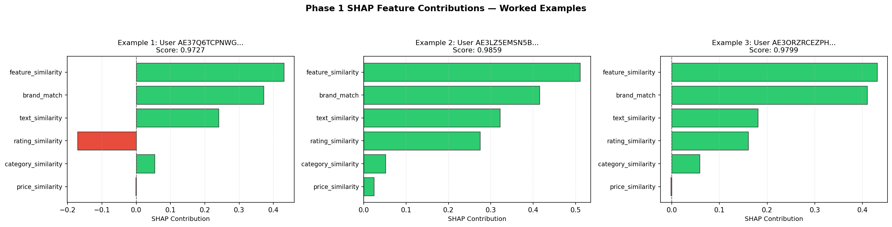

# Section 20: Phase 1 Evaluation Report
**Model**: Content-Based Filtering + Leave-One-Out XGBoost Ranker + SHAP Explainability  
**Dataset**: Amazon Reviews 2023 (`Electronics` category subset)  
**Catalog Size**: 66,320 items  
**Split Protocol**: Chronological Leave-One-Out (Section 8)  
**Leakage Prevention**: Strictly Verified (temporal train/test ordering + LOO ranking training)

---

## 1. Recommendation Quality — Popularity Baseline vs. Phase 1

| Model | Precision@5 | Recall@5 | NDCG@5 | Precision@10 | Recall@10 | NDCG@10 | Evaluated Users |
| :--- | :--- | :--- | :--- | :--- | :--- | :--- | :--- |
| Popularity Baseline | 0.0000 | 0.0000 | 0.0000 | 0.0000 | 0.0000 | 0.0000 | 500 |
| **Content-Based + XGBoost + SHAP (Phase 1)** | **0.0036** | **0.0180** | **0.0123** | **0.0022** | **0.0220** | **0.0137** | **500** |

---

## 2. Cold-Start vs. Seen-in-Training Analysis

| Group | Description | User Count | % of Test Users | Precision@10 | Recall@10 | NDCG@10 |
| :--- | :--- | :--- | :--- | :--- | :--- | :--- |
| **Group A** | Held-out item **SEEN** in training history | 222 | 44.4% | 0.0018 | 0.0180 | 0.0128 |
| **Group B** | Held-out item **UNSEEN** in training (Catalog Cold-Start) | 278 | 55.6% | 0.0025 | 0.0252 | 0.0144 |
| **Overall** | Combined test population | 500 | 100.0% | 0.0022 | 0.0220 | 0.0137 |

---

## 3. Global SHAP Feature Importance (Section 13)

| Feature | Mean |SHAP Value| |
| :--- | :--- |
| `feature_similarity` | 0.4359 |
| `brand_match` | 0.3845 |
| `text_similarity` | 0.2549 |
| `rating_similarity` | 0.2437 |
| `category_similarity` | 0.0559 |
| `price_similarity` | 0.0146 |

---

## 4. Worked SHAP Examples

### Example 1: User `AE37Q6TCPNWG...`
- **Recommended Product**: `[B093BP318W]` RAZERMIC MXR10 Camera Microphone, Professional External Shotgun Mic with Shock Mount and Deadcat Windscreen, Shotgun Video Microphone for iPhone, Android Smartphones, GoPro, Canon, Sony, Nikon
- **Brand**: `razermic` | **Category**: `Accessories` | **Price**: $None
- **Predicted Ranking Score $P(\text{like})$**: `0.9727`
- **SHAP Contributions**:
  - `feature_similarity`: +0.4304
  - `brand_match`: +0.3716
  - `text_similarity`: +0.2403
  - `rating_similarity`: -0.1716
  - `category_similarity`: +0.0540
  - `price_similarity`: -0.0015
- **Natural-Language Explanations**:
  - *Similar product features*
  - *Strong match with razermic products in your history*
  - *Similar to products you previously liked*
  - *Rating variance compared to your standard preferences*

### Example 2: User `AE3LZ5EMSN5B...`
- **Recommended Product**: `[B07JZ19WVS]` PERLESMITH Full Motion TV Wall Mount for 37-82 inch TVs up to 132 lbs, Max VESA 600x400mm, TV Bracket with Dual Articulating Arms, Tilt, Swivel, Extension, 16" Wood Studs, PSLFK1
- **Brand**: `perlesmith` | **Category**: `Accessories` | **Price**: $56.99
- **Predicted Ranking Score $P(\text{like})$**: `0.9859`
- **SHAP Contributions**:
  - `feature_similarity`: +0.5104
  - `brand_match`: +0.4147
  - `text_similarity`: +0.3214
  - `rating_similarity`: +0.2743
  - `category_similarity`: +0.0514
  - `price_similarity`: +0.0245
- **Natural-Language Explanations**:
  - *Similar product features*
  - *Strong match with perlesmith products in your history*
  - *Similar to products you previously liked*
  - *Highly rated by users with similar standards*

### Example 3: User `AE3ORZRCEZPH...`
- **Recommended Product**: `[B09MQK6PKR]` Bluetooth 5.1 Wireless Earbuds,DIGITNOW Deep Bass Sound 50H Playtime IPX8 Waterproof Earphones with Wireless Charging Case Microphone in-Ear Stereo Headphones Noise Cancelling for Sports (DT28)
- **Brand**: `digitnow` | **Category**: `Earbud Headphones` | **Price**: $None
- **Predicted Ranking Score $P(\text{like})$**: `0.9799`
- **SHAP Contributions**:
  - `feature_similarity`: +0.4308
  - `brand_match`: +0.4100
  - `text_similarity`: +0.1804
  - `rating_similarity`: +0.1603
  - `category_similarity`: +0.0584
  - `price_similarity`: -0.0024
- **Natural-Language Explanations**:
  - *Similar product features*
  - *Strong match with digitnow products in your history*
  - *Similar to products you previously liked*
  - *Highly rated by users with similar standards*
